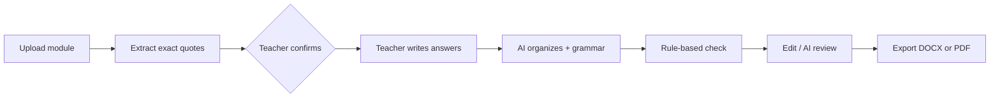

# 🐻 Bear-Light: ILAW Drafting Assistant

A drafting assistant for DepEd teachers writing **ILAW lesson plans**. The teacher writes the lesson. The AI only reads the module, tidies the order and grammar, and a rule-based checker flags what's missing.

**Live app:** [YOUR-RENDER-URL]((https://bear-light.onrender.com/)) *(free hosting: if it's asleep, wait about a minute for it to wake up)*


## What it does

1. **Header:** school, division, region, logos, teacher, grade and section.
2. **Module:** upload a PDF, DOCX, PPTX or TXT.
3. **Confirm:** the app pulls out the Learning Competency, Standards, Objectives and References as **exact quotes** from your module. You tick what to use. Quotes the AI can't find word-for-word in the module are thrown away.
4. **Your answers:** you write the Pre-Lesson, session flow, assessment and the rest. Blank stays blank.
5. **Draft:** the AI fixes order and grammar only. You can edit, run the structure check, ask for an AI review, then **export to Word** or print to PDF.


## Why it's built this way

- **The teacher owns the content.** Competencies, standards and objectives are locked to what the module actually says. The AI can't invent them.
- **Rules live in code, not just prompts.** The AI can't add numbers, drop content or fill a blank answer. If it tries, your original text is kept.
- **AI is advisory.** The structure check is deterministic. The AI review is a second opinion, and its quotes are verified against the draft.



## Privacy: read this before using it

- The server **stores nothing**: no database, no accounts, and logs contain only provider names and timings.
- But your text **is sent to third-party AI providers** (Gemini, Mistral, OpenRouter) to be processed. Free tiers may keep or use prompts.
- **Never enter student names or personal information.**
- Logos stay in your browser and go to the server only when you export the Word file. They're never sent to an AI.

## Run it locally

```powershell
cd backend
python -m venv .venv
.venv\Scripts\activate
pip install -r requirements-dev.txt
copy .env.example .env      # then paste your API keys into .env
uvicorn main:app --reload --port 8000
```

Open http://localhost:8000. At least one provider key is needed. Run the tests (no keys needed) with `python -m pytest -q`.

## Deploy (Render, free)

1. Push to GitHub. Check that `git status` never shows `backend/.env`.
2. In Render: **New → Blueprint**, pick this repo (it reads `render.yaml`).
3. Enter your API keys when asked. They are never stored in git.
4. After it's live, `/docs` and `/api/debug/probe-all` should both return Not Found.

The free tier sleeps after 15 minutes idle and takes about a minute to wake. A Dockerfile is included for other hosts.

## Security notes

- Keys live only in the host's environment settings and in your local `backend/.env`.
- `DEBUG_ENDPOINTS` must **never** be set in production.
- AI endpoints are rate limited per IP and for the whole site. There is **no login**, so anyone with the link uses your AI quota. Share it carefully.
- Rotate any key that was ever pasted somewhere public.

## Tech

FastAPI · plain HTML/CSS/JS (no build step) · python-docx for Word export · Mocha theme.

| File | Job |
|---|---|
| `backend/main.py` | API, provider fallback, rate limit, DOCX export, serves the frontend |
| `backend/pipeline.py` | Extract → organize → grammar → check |
| `backend/prompts.py` | AI prompts |
| `frontend/index.html` | Page structure |
| `frontend/css/styles.css` | All styling, colors at the top |
| `frontend/js/api.js` | The only file that calls the backend |
| `frontend/js/preview.js`, `wizard.js`, `logos.js`, `main.js` | Draft view, form steps, logo upload, wiring |

`compliance.py`, `review.py` and the `/api/generate-dll` endpoints are the old DLL generator and are not used by the ILAW screens.

## Status

Work in progress. A draft is a starting point: **the teacher must review it before use**. It does not check DepEd compliance or official approval.
